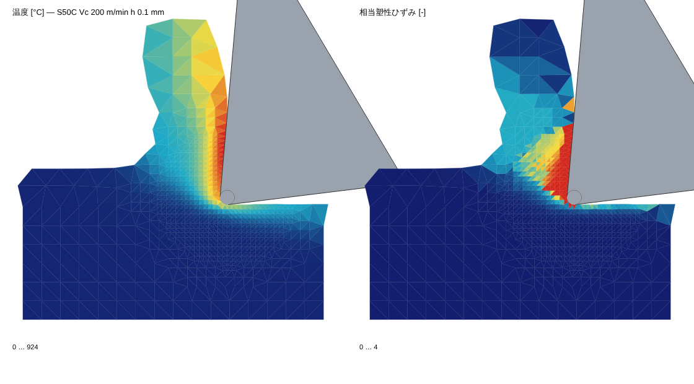

# ネイティブ版 (Windows): 切りくず生成 FEM

Web 版 (リポジトリ直下) は軽量版として残し、より詳細な計算はネイティブ版で行う。
構成は Tauri + Rust: 画面は Web 版の Three.js をそのまま使い、重い計算は Rust のコアで行う。

## 構成

```
native/
  Cargo.toml                 ワークスペース
  crates/chipfem/            2 次元 平面ひずみ 陽解法 FEM (切りくず生成)
    src/material.rs          Johnson–Cook (Web 版の Oxley 予測と同じ定数)、物性
    src/mesh.rs              3 角形メッシュ、形状関数、境界
    src/solver.rs            陽解法 (中心差分、質量スケーリング)、平均節点圧力、Jaumann + J2 リターンマップ、熱
    src/tool.rs              刃先丸みつきの剛体工具、符号付き距離
    src/remesh.rs            リメッシュ (境界の打ち直し、四分木の種点、制約付き Delaunay、状態量の写像)
    src/cutting.rs           直交切削の段取り・実行・結果 (切削抵抗、切りくず厚さ、温度)
    examples/orthogonal.rs   コマンドラインで実行し、温度と塑性ひずみの分布を SVG に出す
    tests/verify.rs          閉じた解との比較
    tests/cutting.rs         S50C の直交切削を Oxley 理論と比較
  app/                       Windows アプリ (Tauri v2)
    ui/index.html            画面: フライス加工 (Web 版を同梱) と 切りくず FEM
    src-tauri/               Rust 側 (FEM を別スレッドで実行し、進み具合をイベントで画面へ)
```

単位系: mm, s, t (トン), N, MPa, mJ, °C (密度 t/mm³、比熱 mJ/(t·K) = 10⁶ × J/(kg·K)、熱伝導率 mJ/(s·mm·K) = W/(m·K))。

## ロードマップ

| 段階 | 内容 | 状態 |
|---|---|---|
| M1 | FEM の核: 線形 3 角形 + 平均節点圧力 (体積ロック回避)、Jaumann 速度の J2 塑性 (Johnson–Cook、ひずみ速度・温度)、塑性発熱 (β) と熱伝導、剛体工具 (刃先丸み) の運動学的接触とクーロン摩擦、摩擦発熱 | 済 |
| M2 | 切りくず生成: 要素がつぶれる前に被削材を作り直す (境界の取り出し → 刃先近くを細かく → 制約付き Delaunay → 状態量の写像)。分離基準なしで刃先の丸みで材料が上下に分かれる (AdvantEdge と同じ考え方)。切削抵抗・せん断角・切りくず厚さ・温度分布 | 済 |
| M3 | Windows アプリ (Tauri): Web 版の画面に「切りくず FEM」画面 (応力・温度・ひずみの色分け、力の時間変化)。GitHub Actions で Windows インストーラー | 済 (Windows の実機で動作確認: S50C の標準条件で主分力 220 N/mm、コマンドライン版と同じ) |
| M4 | 本体との連携: FEM の切削抵抗から切削係数 (Ktc Krc、エッジ係数) を出してフライスのシミュレーションへ。Oxley 予測・実測波形の同定との比較 | 試験的 (下記) |
| M5 | 工具の温度: 温まった後の工具の温度分布 (接触面は切りくずの温度、刃先から 2 mm 先は室温として、工具の中の定常の熱伝導を解く) | 済 |
| 次 | すくい面の近くのメッシュを細かくする (背分力・エッジ係数の精度、薄い切りくずでの安定) | |
| 以降 | 工具摩耗 (工具温度から)、せん断型 (鋸歯状) 切りくずの損傷モデル、3 次元 (斜め切削) | |

## 検証 (`cargo test --release`)

- 平面ひずみ圧縮 (摩擦なし): 応力が Johnson–Cook の (2/√3)·σ_y((2/√3)|ln h/h₀|) と 1.2 % 以内 (ひずみ 0.05〜0.3)。断熱 β = 1 で塑性仕事 = 蓄えた熱、塑性仕事は σ_y の積分と 2 % 以内
- すくい面で弾性の棒を押す: 力が平面ひずみの E/(1−ν²)·(u/L)·H と 0.2 %
- 逃げ面で押し付けながら滑らせる: 摩擦力 / 押し付け力 = 0.28 (μ = 0.3、刃先の丸みの部分の斜めの接触と、くっついている節点の分だけ小さい)

## 直交切削の結果 (M2)

S50C (AISI 1045)、切削速度 200 m/min、切取り厚さ 0.1 mm、すくい角 5°、逃げ角 7°、刃先丸み 0.02 mm、μ = 0.6、切削長 1 mm (幅 1 mm あたり、後半 40 % の平均)。比較は Web 版の Oxley 予測 (同じ Johnson–Cook 定数、鋭い刃先、摩擦角はその釣り合いから 30.4° ≈ μ 0.59)。



| | FEM | Oxley |
|---|---|---|
| 主分力 Fc | 216 N/mm | 196 N/mm (+10 %) |
| 背分力 Ft | 81 N/mm | 93 N/mm (−13 %) |
| 切りくず厚さ | 0.233 mm | 0.229 mm (+2 %) |
| せん断角 | 24.0° | 24.3° |
| 最高温度 | 998 °C (すくい面) | 793 °C (工具–切りくず界面の平均) |

工具面の摩擦は付着–すべり (Zorev): 摩擦応力 τ = min(μ·σ_n, k)、k は接する要素の相当応力 /√3。刃先近くの高い面圧の所では材料のせん断強さで頭打ちになって張り付き、離れた所ではすべる。計算時間 約 20 秒 (4 コア、要素 約 1600、リメッシュ 134 回)。

**感度** (同じ条件で 1 つだけ変える):

| | Fc | Ft | 切りくず厚さ | 最高温度 |
|---|---|---|---|---|
| 標準 (刃先の要素 0.0125 mm、質量スケーリング 100 倍、付着–すべり摩擦) | 220 | 85 | 0.231 | 885 |
| 刃先の要素を 0.006 mm に (計算 112 秒) | 231 (+5 %) | 88 (+4 %) | 0.263 (+14 %) | 915 (+3 %) |
| 質量スケーリングを 20 倍に (クーロン摩擦のみでの比較) | +6 % | −7 % | +2 % | 0 % |
| 摩擦をクーロンのみに (頭打ちなし) | 220 (0 %) | 83 (−2 %) | 0.232 | 947 (+7 %) |

クーロン摩擦のみでは、刃先の要素を半分にすると背分力 −18 %、温度 +15 % と動いた (刃先近くで μ·σ_n が材料のせん断強さを超え、すくい面の薄い層の解像度で結果が変わる)。付着–すべり摩擦でそれが 4 %・3 % に収まった。切りくず厚さ (すくい面から切りくずの外側までの最大距離で測る) はまだ 14 % 動くので、測り方 (外側の粗い要素の影響) とメッシュ収束を次に詰める。

## 工具の温度 (M5)

切削の計算は、工具に熱が逃げない (断熱) 扱いで行い、摩擦熱は全部切りくず側に入れる。計算する時間は 1 ミリ秒もないので、工具に熱伝導を付けるとその間は冷たいままで接触面の熱を吸い続け、切りくず側が冷えて切削抵抗が 4 割ほど高く出る (実際の工具は数秒で温まり、接触面からはほとんど熱を吸わない)。そこで、切削の計算のあと、工具 (超硬、熱伝導率 80 W/(m·K)) の刃先から 2 mm の部分をメッシュに切り、切りくずが触れている面はその場の切りくずの温度、刃先から 2 mm 先は室温、ほかの面は断熱として、工具の中の定常の熱伝導を解く (Gauss–Seidel)。上の図の左の工具がその結果で、最高温度は刃先そのものではなく、すくい面を少し上がった切りくずのこすれる所 (S50C の標準条件で約 1000 °C) に出る (クレーター摩耗の位置)。

## FEM からフライス加工の切削係数 (M4、試験的)

切取り厚さを変えて FEM を数回流し、主分力・背分力を厚さに対する直線にする。切片がエッジ係数 (Kte Kre)、残りからせん断応力・せん断角・摩擦角を出し、ねじれ角で斜め切削に換算して Ktc Krc Kac にする (Web 版の Oxley 予測と同じ換算)。後半の主分力のばらつきが 10 % 以上の回と、温度が融点の 95 % を超えた回は除外する。アプリの「フライス加工で使う」で、フライス加工タブの材料の係数に渡す。

S50C、200 m/min、すくい角 5°、ねじれ角 30°、μ 0.6 (すくい面に沿った細かいメッシュあり、4 本とも安定、計算 7 分):

| 切取り厚さ | 主分力 | 背分力 | せん断角 | 摩擦角 |
|---|---|---|---|---|
| 0.06 mm | 153 N/mm | 67 N/mm | 19.6° | 15.2° |
| 0.09 mm | 224 N/mm | 77 N/mm | 24.2° | 14.5° |
| 0.12 mm | 287 N/mm | 86 N/mm | 24.8° | 14.2° |
| 0.16 mm | 379 N/mm | 105 N/mm | 24.1° | 14.9° |

| 係数 | FEM | Oxley 予測 | 表の値 |
|---|---|---|---|
| Ktc [N/mm²] | 2350 | 2373 | 2100 |
| Krc [N/mm²] | 345 | 1129 | 850 |
| Kac [N/mm²] | 981 | 486 | 400 |
| Kte [N/mm] | 19 | (出せない) | 35 |
| Kre [N/mm] | 43 | (出せない) | 45 |

主分力側 (Ktc) とエッジ係数 (Kte Kre) はもっともらしい。背分力のうち刃先の丸みの分 (Kre) を引いた残りが小さく、摩擦角が約 15° (Oxley は 30°) と小さく出るため、Krc が小さく Kac が大きくなる。すくい面の摩擦 (μ と付着の頭打ち) の決め方が次の課題。

**すくい面の接触の分布** (`CHIPFEM_PROFILE=1` で orthogonal の例が後半 40 % の平均を表に出す。s はすくい面が刃先の丸みにつながる所から測る): S50C、200 m/min、0.1 mm、μ 0.6 で、

| | FEM | Oxley |
|---|---|---|
| すくい面の垂直力 N / 摩擦力 F [N/mm] | 166 / 60 | 187 / 110 |
| すくい面だけの摩擦角 | 19.9° | 30.4° |
| 接触長さ | 約 0.19 mm | 0.25 mm |
| 摩擦応力 τ [MPa] | 400 (刃先側) → 200 (接触の終わり) | 442 (一様) |
| 面圧 σn [MPa] | 1300 → 400 | 756 (平均) |
| 接触面の温度 [°C] | 750 → 980 | 793 (平均、ψ = 0.7) |

- すくい面のほぼ全体で τ ≈ k (切りくずのせん断強さ、τ/k = 0.94〜0.98)。μσn (0.6 × 1000 MPa) は k より大きく、**クーロンの μ は効いていない**。摩擦力を決めているのは接触面の温度での切りくずの強さと接触長さで、Oxley との差 (F が 0.55 倍) は τ (0.8 倍) と接触長さ (0.77 倍) から来る。μ を上げても背分力は増えない (クーロンのみでも同じだったことと合う)。
- 刃先の丸みが直接受ける力は 主分力 約 50、背分力 約 20 N/mm で、切取り厚さ (0.06〜0.16 mm) によらずほぼ一定。直線の切片 (Kte 19、Kre 43) とは分け方が違う。すくい面だけの摩擦角は 23.4° (0.06 mm)、19.9° (0.1 mm)、18.4° (0.16 mm) と厚さとともに下がり、それが背分力の傾き (Krc) を小さくしている。切片から出す 15° は、この傾きの小ささがエッジ係数に吸われたもの。
- 次の候補: (1) すくい面の付着域で節点が滑らないようにする (今は τ = k で滑り、すくい面の薄い層が大きなひずみ速度でせん断されないので、k がひずみ速度・ひずみ硬化の分だけ低めに出ている可能性)、(2) 工具への熱の分配 (今は摩擦熱を全部切りくずへ)。
- 切取り厚さ 0.2 mm (切削長 1.6 mm) は今の版では最後まで計算できた (260 秒、要素 約 5200)。ただし主分力が後半に 480 → 417 N/mm と下がり続け、最高温度は接触の終わり (刃先から約 0.4 mm) で 1100 °C。定常に届いていない。

**すくい面に沿った細かいメッシュ** (標準で入る): 刃先から切取り厚さの 3 倍までのすくい面に沿って、面に接する要素を刃先の要素の半分の大きさにする (切りくずが張り付いてせん断される薄い層)。これがないと背分力が厚さによらず一定になり (エッジ係数 Kte 約 84 N/mm)、0.06 mm 以下では温度が暴走した。

**数値計算の安定化** (この段階で入れたもの): 工具に触れるのは被削材の表面の節点だけ (内部の節点まで押し出すと要素がつぶれる)、つぶれかけた要素はすぐに作り直す、作り直したメッシュが元の形と面積で合わないか裏返る要素があればその回は見送る、摩擦熱は「摩擦力 × 実際に残ったすべり」(張り付いている所は 0。以前は二重に数えていた)、Johnson–Cook の温度による軟化は室温の強さの 10 % で止める (固体のモデルは溶けられないため)、細い要素の熱伝導は陽解法の安定限界までに抑える。

## Windows アプリ (M3)

`native/app`: Tauri v2。画面は 2 つのタブで、「フライス加工」は Web 版のオフライン 1 ファイル版 (`dist/machining-sim-offline.html` を `ui/mill.html` として同梱)、「切りくず FEM」は条件の入力、計算中の切削抵抗のグラフ、温度・塑性ひずみ・相当応力の分布 (約 0.5 秒ごとに更新)、定常値の表。FEM は Rust 側の別スレッドで動き、「止める」で途中終了できる。

インストーラー (.msi / .exe) は GitHub Actions (`.github/workflows/native.yml`) の Windows ランナーで作り、成果物 `machining-sim-windows` として取り出せる。Linux のランナーでは FEM のテストを回す。

## ビルド

```
cd native
cargo test --release                                   # FEM の検証と直交切削の回帰テスト
cargo run --release --example orthogonal -- S50C 200 0.1 5 1.0 out.svg 0.6
```

Windows でアプリを作るには、Rust と Node.js を入れてから:

```
npm ci && npm run build                                # Web 版 (フライス加工タブ)
copy dist\machining-sim-offline.html native\app\ui\mill.html
npm install -g @tauri-apps/cli@2
cd native\app\src-tauri && tauri build              # native\target\release\bundle に .msi と .exe
```
